## Bloque 1: Panorama del Framework

- **Origen y mantenedor:** Vue.js fue creado por Evan You en 2014 y es mantenido por él y la comunidad open-source.
- **Versión actual:** Vue 3 (usando Composition API).
- **Licencia:** MIT.
- **Filosofía:** Es un "Framework Progresivo". A diferencia de Angular (que es monolítico) o React (que es solo una librería), Vue permite adoptarlo gradualmente, desde mejorar una parte de un HTML hasta construir una SPA completa.

## Bloque 2: Instalación y Estructura

- **Herramienta usada:** `create-vue` (basado en Vite), que es el estándar oficial actual.
- **Estructura de carpetas:**
  - `src/views`: Para las páginas completas (rutas).
  - `src/components`: Para piezas reutilizables de la UI.
  - `src/stores`: Para el estado global con Pinia.
  - `src/router`: Para la configuración de rutas.
- **Error común y solución:** Al inicializar Git, tuvimos un error de permisos en Windows (`dubious ownership`). Lo solucionamos marcando la carpeta como segura con el comando: `git config --global --add safe.directory [ruta_del_proyecto]`.
- **Tiempo de configuración:** 15 minutos, desde `npm create vue@latest` hasta ver el servidor corriendo en `localhost:5173`, incluyendo la resolución del error de permisos de Git.
- **Otro error real:** al escribir mal el comando (`npm cretae vue@latest`) apareció `Unknown command: "cretae"`. Se corrigió escribiendo `npm create vue@latest`.

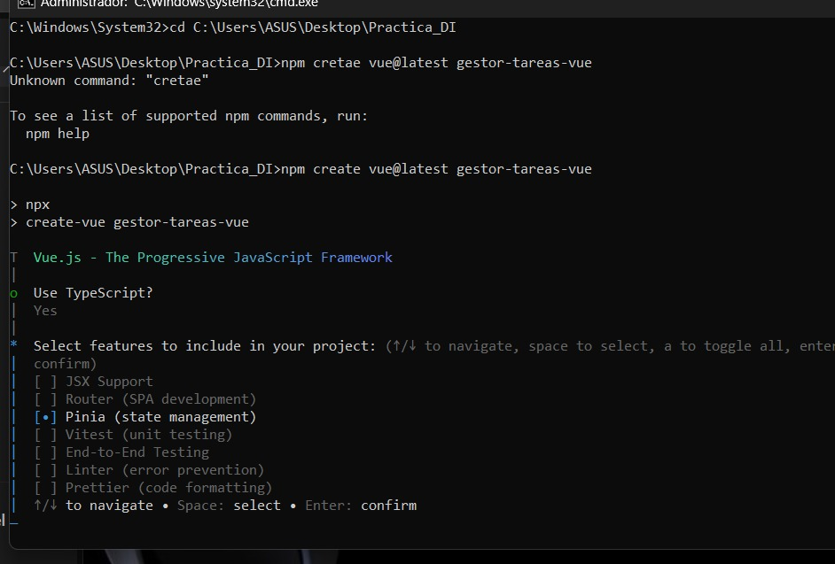

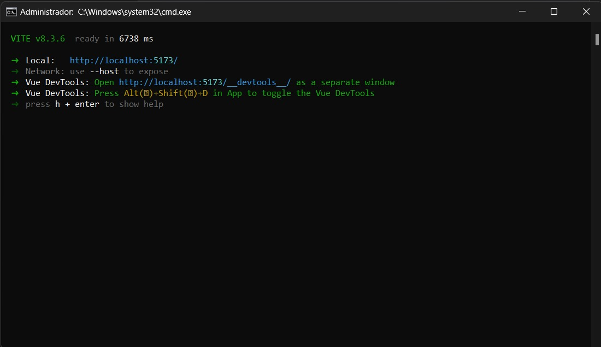

| Tiempo de configuración inicial (min) | 15 | `docs/img/17-instalacion-create-vue.png`, `docs/img/18-vite-corriendo.png` |

## Bloque 3. Componentes en Vue 3

### 3.1. ¿Qué son los componentes?

Los componentes son partes independientes y reutilizables de una aplicación. Permiten dividir la interfaz en secciones más pequeñas, facilitando su organización, mantenimiento y reutilización.

En Vue 3 se pueden crear componentes mediante archivos `.vue`, conocidos como Single-File Components (SFC). Estos archivos pueden contener tres secciones principales:

- `<script setup>`: contiene la lógica del componente.
- `<template>`: define los elementos que se muestran en pantalla.
- `<style>`: contiene los estilos visuales.

### 3.2. Plantillas (Templates)

Vue utiliza plantillas basadas en HTML para definir cómo se presenta la información. Dentro de ellas se pueden utilizar expresiones, directivas y enlaces de datos.

Ejemplo:

```vue
<template>
  <h2>{{ titulo }}</h2>
  <p>Bienvenido al gestor de tareas</p>
</template>

<script setup lang="ts">
const titulo = "Mis tareas";
</script>
```

La expresión `{{ titulo }}` permite mostrar el valor de una variable dentro de la plantilla.

### 3.3. Props y eventos

**Props:** permiten enviar información desde un componente padre hacia un componente hijo. Son útiles para reutilizar un mismo componente mostrando información diferente.

Ejemplo:

```vue
<script setup lang="ts">
defineProps<{
  titulo: string;
}>();
</script>

<template>
  <h3>{{ titulo }}</h3>
</template>
```

**Eventos:** permiten que un componente hijo comunique una acción al componente padre. En Vue se utiliza `defineEmits()` para declarar los eventos y `emit()` para enviarlos.

Ejemplo:

```vue
<script setup lang="ts">
const emit = defineEmits<{
  eliminar: [];
}>();
</script>

<template>
  <button @click="emit('eliminar')">Eliminar</button>
</template>
```

El componente padre puede escuchar el evento mediante `@eliminar`.

### 3.4. Renderizado condicional y listas

Vue dispone de directivas para controlar qué elementos se muestran en pantalla.

- `v-if`: muestra un elemento cuando se cumple una condición.
- `v-else`: muestra una alternativa cuando la condición anterior no se cumple.
- `v-show`: controla la visibilidad de un elemento mediante CSS.
- `v-for`: permite recorrer una lista y generar elementos dinámicamente.

Ejemplo:

```vue
<template>
  <p v-if="tareas.length === 0">No hay tareas registradas.</p>

  <div v-else>
    <p v-for="tarea in tareas" :key="tarea.id">
      {{ tarea.title }}
    </p>
  </div>
</template>
```

En este ejemplo, `v-for` recorre el arreglo de tareas y muestra cada título. El atributo `:key` permite identificar cada elemento de la lista.

### 3.5. Ciclo de vida de los componentes

El ciclo de vida representa las diferentes etapas por las que pasa un componente desde que se crea hasta que se elimina.

Los principales momentos son:

| Etapa         | Descripción                                      |
| ------------- | ------------------------------------------------ |
| Creación      | Se inicializa el componente y su lógica.         |
| Montaje       | Se muestra el componente en el DOM.              |
| Actualización | Se actualiza cuando cambian sus datos reactivos. |
| Desmontaje    | Se elimina el componente de la interfaz.         |

Vue proporciona funciones llamadas _Lifecycle Hooks_ para ejecutar código en determinados momentos:

- `onMounted()`: se ejecuta después de que el componente se muestra en el DOM.
- `onUpdated()`: se ejecuta después de una actualización del DOM.
- `onUnmounted()`: se ejecuta después de eliminar el componente.

Ejemplo:

```vue
<script setup lang="ts">
import { onMounted } from "vue";

onMounted(() => {
  console.log("El componente se ha cargado");
});
</script>
```

### 3.6. Aplicación práctica en el gestor de tareas

En nuestro proyecto se desarrolló el componente `TaskCard.vue`, encargado de mostrar la información de una tarea y permitir realizar acciones como completarla, editarla o eliminarla.

Este componente recibe una tarea mediante `props` y comunica las acciones mediante eventos.

En `HomeView.vue` se reutiliza tres veces mediante `v-for`, enviando información diferente en cada caso:

```vue
<TaskCard
  v-for="task in filteredTasks"
  :key="task.id"
  :task="task"
  @toggle="toggleTask"
  @edit="editTask"
  @delete="deleteTask"
/>
```

De esta manera, no es necesario crear un componente diferente para cada tarea. El mismo componente presenta la información de todas ellas.

### 3.7. Problemas encontrados

Durante el desarrollo se presentaron algunos inconvenientes relacionados con el funcionamiento de los componentes.

Error encontrado 1: Al trabajar con el formulario de tareas, fue necesario sincronizar los campos de título y descripción con la información de la tarea seleccionada para editar. Sin esta sincronización, el formulario podía conservar los datos anteriores o aparecer vacío.

Código utilizado:

```vue
watch( () => props.task, (task) => { title.value = task?.title ?? "";
description.value = task?.description ?? ""; }, { immediate: true }, );
```

Solución aplicada: Se utilizó watch() para detectar los cambios en la tarea recibida mediante props y actualizar automáticamente los campos del formulario. También se agregó immediate: true para cargar los datos desde el inicio cuando se selecciona una tarea.

### 3.8. Conclusión

Los componentes de Vue 3 permiten organizar una aplicación en elementos reutilizables y mantener separadas sus responsabilidades. Mediante props, eventos y directivas como `v-if` y `v-for`, fue posible desarrollar una interfaz organizada y funcional para el gestor de tareas.

### 3.9. Fuentes de consulta

- [Vue.js – Componentes básicos](https://vuejs.org/guide/essentials/component-basics.html)
- [Vue.js – Props](https://vuejs.org/guide/components/props.html)
- [Vue.js – Renderizado de listas](https://vuejs.org/guide/essentials/list.html)
- [Vue.js – Renderizado condicional](https://vuejs.org/guide/essentials/conditional.html)
- [Vue.js – Ciclo de vida](https://vuejs.org/guide/essentials/lifecycle.html)

## Bloque 4. Reactividad, estado y navegación

### 4.1. Reactividad en Vue 3

La reactividad de Vue 3 permite que la información que vemos en pantalla se actualice automáticamente cuando cambian los datos. Así, no tenemos que modificar el HTML a mano después de cada operación.

En el gestor de tareas usamos esta función para mostrar las tareas que llegan de la API, indicar si están completadas y aplicar filtros. También permite mostrar mensajes mientras se cargan los datos o cuando ocurre un error. Por ejemplo, al marcar una tarea como completada, el cambio aparece en la lista que ve el usuario.

### 4.2. Uso de `ref()` y `reactive()`

Para que Vue detecte los cambios en los datos, podemos usar funciones como `ref()` y `reactive()`.

#### `ref()`

Con `ref()` podemos guardar un dato y hacer que Vue detecte sus cambios. Sirve para valores simples, listas u objetos. Para leer o cambiar ese dato desde TypeScript, usamos `.value`.

```ts
import { ref } from 'vue'

const loading = ref(false)
loading.value = true
```

En el proyecto guardamos la lista de tareas y los datos de carga y error en un store, que es donde reunimos la información que comparten los componentes:

```ts
const tasks = ref<Task[]>([])
const loading = ref(false)
const error = ref('')
```

Cuando cambia alguno de estos valores, Vue actualiza los componentes que lo usan.

#### `reactive()`

`reactive()` permite trabajar con un objeto cuyos cambios también detecta Vue. Podemos acceder a sus propiedades directamente, sin escribir `.value` en cada una.

```ts
import { reactive } from 'vue'

const formulario = reactive({
  title: '',
  description: '',
  completed: false
})

formulario.title = 'Estudiar Vue'
```

Este ejemplo explica cómo funciona `reactive()`, aunque no lo incorporamos al gestor de tareas. En el proyecto elegimos `ref()` porque cubría lo que necesitábamos y era fácil de entender.

### 4.3. Datos compartidos con Pinia

Pinia permite reunir en un mismo lugar los datos y las operaciones que necesitan varios componentes de Vue. Para ello, creamos el archivo `src/stores/tasks.ts`, donde definimos el store `useTaskStore`.

El store guarda estos datos:

| Dato | Para qué sirve |
|---|---|
| `tasks` | Guarda la lista de tareas. |
| `loading` | Indica si se están cargando las tareas. |
| `error` | Guarda un mensaje de error cuando falla la consulta. |

También incluye las acciones `fetchTasks`, `addTask`, `editTask`, `removeTask` y `toggleTask`. Estas usan el servicio HTTP, que se encarga de comunicarse con el servidor, para consultar o modificar las tareas.

Una versión simplificada del store es:

```ts
export const useTaskStore = defineStore('tasks', () => {
  const tasks = ref<Task[]>([])
  const loading = ref(false)
  const error = ref('')

  return { tasks, loading, error }
})
```

En `HomeView.vue` usamos el store para obtener las tareas y trabajar con ellas. Las solicitudes HTTP quedan fuera de esta vista, lo que ayuda a mantener el código organizado.

### 4.4. Vue Router y navegación

Vue Router permite pasar de una vista a otra sin recargar toda la aplicación. En el proyecto configuramos estas rutas:

| Ruta | Vista | Para qué sirve |
|---|---|---|
| `/` | `HomeView.vue` | Mostrar y administrar las tareas. |
| `/task/:id` | `TaskDetailView.vue` | Mostrar la vista de una tarea concreta. |

La parte `:id` cambia según la tarea seleccionada y permite identificarla. Desde la tarjeta de una tarea podemos crear un enlace con `RouterLink`:

```vue
<RouterLink :to="`/task/${task.id}`">
  Ver detalle
</RouterLink>
```

`RouterView` indica en qué parte de la pantalla se muestra la vista de la ruta actual.


## Bloque 5. Conexión con la API REST y operaciones CRUD

### 5.1. Conexión con una API REST

Una API REST permite que la aplicación envíe y reciba información mediante solicitudes HTTP, es decir, peticiones al servidor. En el proyecto usamos JSON Server para disponer de una API a partir del archivo `db.json`, sin tener que programar toda la parte del servidor.

Para iniciar el servidor, ejecutamos:

```bash
npx json-server db.json --port 3000
```

La lista de tareas se consulta en esta dirección:

```text
http://localhost:3000/tasks
```

Cada tarea tiene las propiedades `id`, `title`, `description` y `completed`, que corresponden a su identificador, título, descripción y estado de finalización:

```json
{
  "id": "1",
  "title": "Estudiar Vue",
  "description": "Repasar conceptos de reactividad",
  "completed": false
}
```

Reunimos el código que se comunica con el servidor en `src/services/taskService.ts`. Allí usamos `fetch()` para hacer las solicitudes y comprobamos `response.ok` para detectar si el servidor devuelve una respuesta de error.


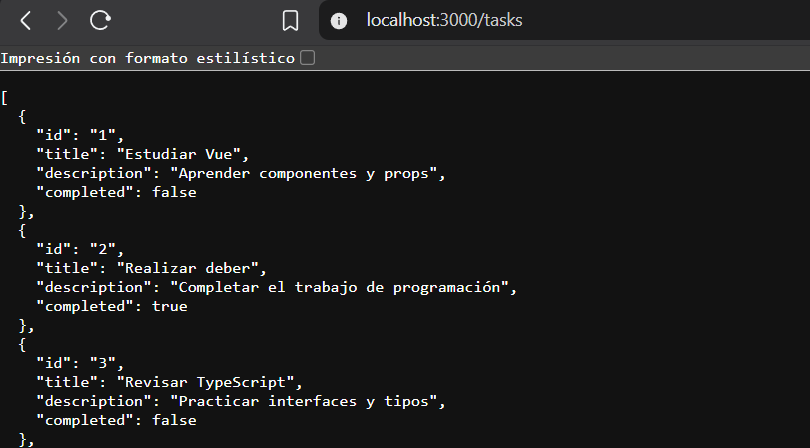

### 5.2. Operaciones CRUD

CRUD es el nombre que agrupa cuatro operaciones: crear, leer, actualizar y eliminar información. En el proyecto las implementamos de esta manera:

| Operación | Método HTTP | Función del servicio | Resultado |
|---|---|---|---|
| Crear | `POST` | `createTask()` | Guarda una tarea nueva. |
| Leer | `GET` | `getTasks()` | Obtiene las tareas guardadas. |
| Actualizar | `PATCH` | `updateTask()` | Edita una tarea o cambia su estado. |
| Eliminar | `DELETE` | `deleteTask()` | Elimina una tarea. |

### Consultar las tareas

Usamos una solicitud GET para obtener la lista guardada en JSON Server:

```ts
const response = await fetch('http://localhost:3000/tasks')

if (!response.ok) {
  throw new Error('Error al obtener tareas')
}

const tasks = await response.json()
```

### Crear una tarea

Al crear una tarea, enviamos su título, descripción y estado mediante POST. JSON Server genera el identificador, por lo que el formulario no necesita calcularlo.

### Actualizar una tarea

Usamos PATCH para cambiar los datos de una tarea existente. Con esta operación podemos editar el título o la descripción y cambiar la propiedad `completed` entre `true` y `false` para marcar la tarea como completada o pendiente.

### Eliminar una tarea

Para borrar una tarea, enviamos una solicitud DELETE con su identificador. Cuando el servidor responde, el store actualiza la lista que aparece en pantalla.

### Tipo de identificador

Al principio, los datos temporales tenían identificadores numéricos. Durante la integración cambiamos el tipo a `string`, porque JSON Server devuelve identificadores de texto que pueden combinar letras y números.

```ts
export interface Task {
  id: string
  title: string
  description: string
  completed: boolean
}
```

Así, la API, los servicios, Pinia y los componentes trabajan con el mismo tipo de identificador.
Creación de una tarea 
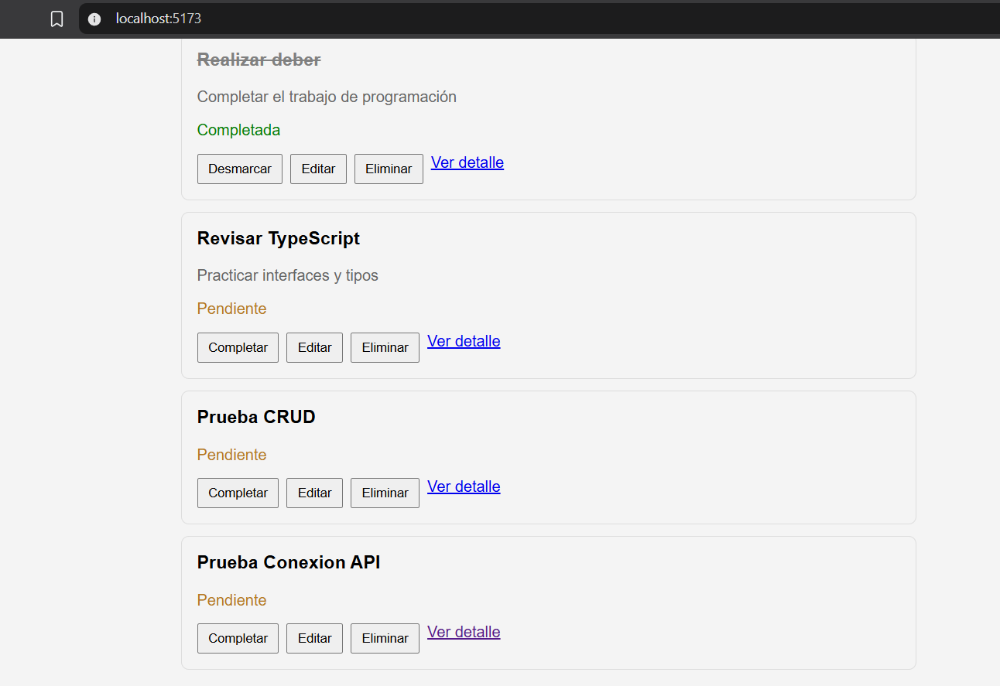
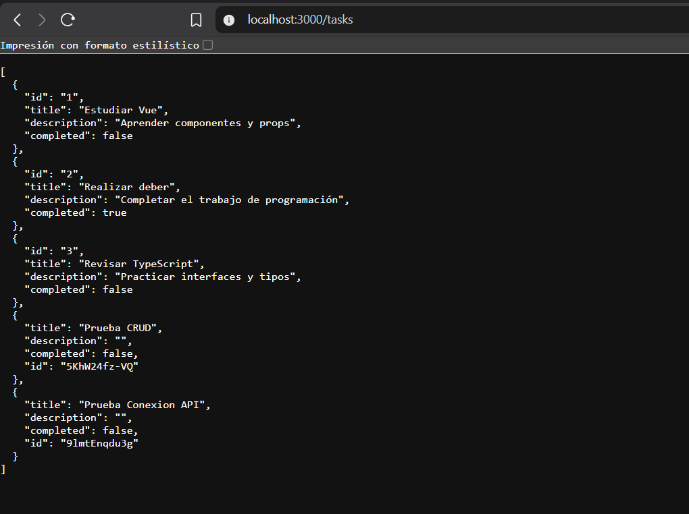
Modificacion de tarea
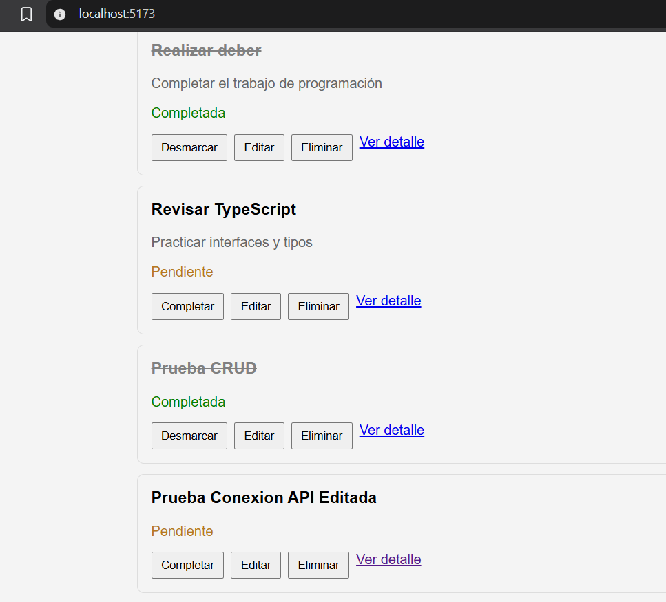
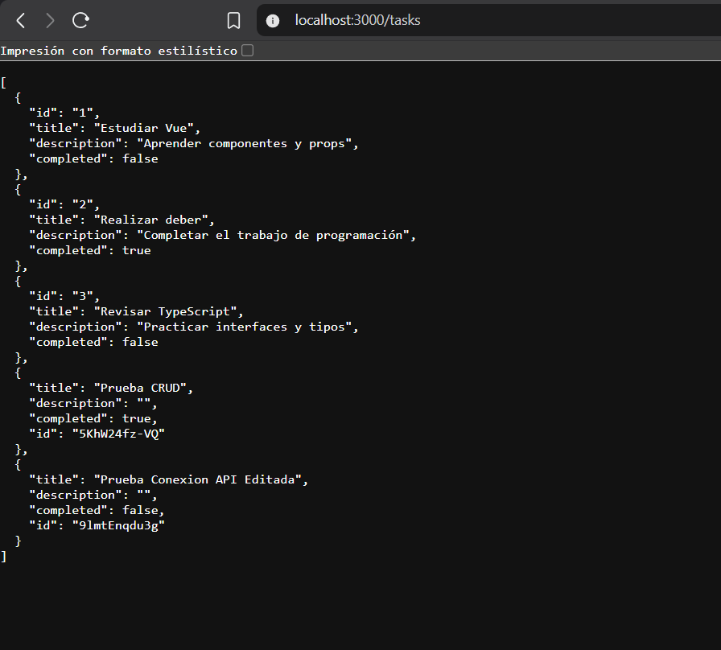


## 5.3. Errores y mensajes de carga

Las solicitudes al servidor pueden fallar si este no está disponible o devuelve una respuesta incorrecta. Para manejar estos casos, comprobamos las respuestas y usamos bloques `try/catch`, que permiten detectar los errores y decidir qué hacer cuando ocurren.

En el store, `loading` indica cuándo se están consultando las tareas y `error` guarda el mensaje que se muestra si la carga falla.

Si detenemos JSON Server y actualizamos la aplicación, aparece este mensaje:

"No se pudieron cargar las tareas"

También manejamos los errores al guardar o eliminar una tarea, para que el usuario reciba un mensaje y sepa que la operación falló.

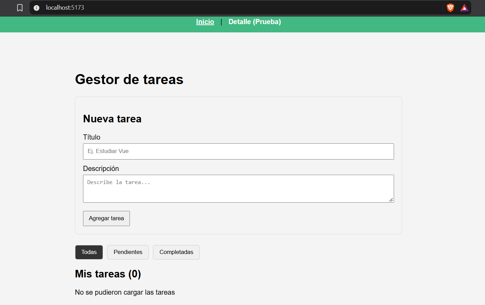

### 5.4. Pruebas manuales y resultados

Probamos las funciones desde la aplicación Vue y revisamos que los cambios también aparecieran en la respuesta de JSON Server.

| Prueba realizada | Resultado |
|---|---|
| Consultar las tareas desde la API | Correcto |
| Crear una tarea nueva | Correcto |
| Editar una tarea existente | Correcto |
| Marcar una tarea como completada | Correcto |
| Eliminar una tarea | Correcto |
| Mantener los cambios después de actualizar la página | Correcto |
| Mostrar un error cuando JSON Server está detenido | Correcto |

También ejecutamos `npm run build`. El comando terminó correctamente: el proyecto pasó la revisión de tipos de datos y generó los archivos para su publicación. Además, ejecutamos `npm run test:unit -- --run`, que aprobó una prueba inicial para comprobar que `App.vue` se monta, es decir, que el componente principal se puede cargar.

### 5.5. Dificultades encontradas y soluciones

Al principio usamos `number` para los identificadores de las tareas temporales. Al conectar la aplicación con JSON Server, encontramos que los identificadores eran de texto. Lo resolvimos definiendo `id: string` y usando ese mismo tipo en los componentes, los servicios y el store.

Durante la compilación apareció el error `Cannot find name 'TaskData'` en `HomeView.vue`. Faltaba importar el tipo `TaskData` desde `src/types/task.ts`. Después de añadirlo, `npm run build` terminó sin errores.
### 5.6. Conclusiones de los bloques 4 y 5

La reactividad de Vue 3 permitió que la pantalla del gestor de tareas se actualizara al cambiar los datos. Con `ref()` manejamos la lista de tareas y los datos de carga y error. Pinia reunió en un mismo lugar las operaciones compartidas por los componentes.

Vue Router permitió organizar la navegación entre la página principal y la ruta de detalle. La conexión con JSON Server mediante `fetch()` hizo posible crear, consultar, actualizar y eliminar tareas, además de conservar los cambios al actualizar la página.

Las pruebas manuales confirmaron que podemos consultar, crear, editar, completar y eliminar tareas. También comprobamos que la aplicación muestra un mensaje cuando no puede comunicarse con el servidor.

### Archivos principales de los bloques 4 y 5

| Archivo | Para qué sirve |
|---|---|
| `src/types/task.ts` | Define los tipos de datos de las tareas. |
| `src/stores/tasks.ts` | Reúne los datos y las acciones compartidas con Pinia. |
| `src/services/taskService.ts` | Se comunica con JSON Server mediante solicitudes HTTP. |
| `src/views/HomeView.vue` | Conecta el store con la pantalla principal. |
| `src/router/index.ts` | Define las rutas de navegación. |
| `src/main.ts` | Registra Pinia y Vue Router en la aplicación. |
| `db.json` | Guarda las tareas que utiliza JSON Server. |


## Bloque 6: Pruebas

### 6.1. Herramientas de pruebas
Usamos **Vitest** como ejecutor de pruebas y **Vue Test Utils** para montar los componentes. Vitest se integra con Vite: reutiliza su configuración y procesa los archivos `.vue` con el mismo plugin. Las pruebas corren en **jsdom**, un DOM simulado en Node, sin abrir navegador ni levantar la API.

### 6.2. Configuración
`vitest.config.ts` fusiona `vite.config.ts` con la sección `test`:

```ts
test: {
  environment: 'jsdom',
  exclude: [...configDefaults.exclude, 'e2e/**'],
  root: fileURLToPath(new URL('./', import.meta.url)),
}
```

Las pruebas están en `src/__tests__/`, carpeta incluida en `tsconfig.vitest.json` y excluida de `tsconfig.app.json`, para que no cuenten como código de la aplicación. Se ejecutan con `npm run test:unit` (modo vigilancia) o `npx vitest run` (una sola vez).

### 6.3. Pruebas implementadas
Resultado final: **5 archivos y 13 pruebas pasando**. Partimos de una línea base de 1 prueba (`App.spec.ts`).

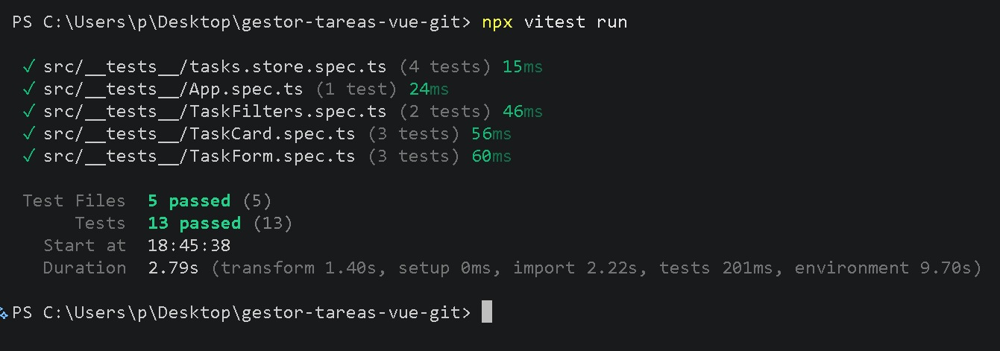

1. **TaskCard.spec.ts (3 pruebas):** comprueba que la tarjeta muestre título, descripción y estado según la prop `task`, que aplique la clase `completed`, y que los botones emitan `toggle` y `delete` con el `id` y `edit` con la tarea completa. `RouterLink` se reemplaza por un *stub* porque no hay router en la prueba.
2. **TaskForm.spec.ts (3 pruebas):** con `setValue` y `trigger('submit')` verifica que `save` se emita con los datos limpios (`trim`) y `completed: false`, que no se emita si el título está vacío, y que en modo edición cargue los datos y emita `cancel`.
3. **tasks.store.spec.ts (4 pruebas):** usa `vi.mock` para reemplazar `taskService`, de modo que no depende de la API. Verifica `fetchTasks` (carga y manejo de error), `toggleTask` y `removeTask`.
4. **TaskFilters.spec.ts (2 pruebas):** comprueba el `v-model` de los filtros y el evento `update:modelValue`.
5. **App.spec.ts (1 prueba):** comprueba que la aplicación se monte.

### 6.4. Errores encontrados y solución
- **`[Vue warn]: Failed to resolve component: RouterLink`** en las 3 pruebas de `TaskCard`. Las pruebas pasaban igual, pero con advertencias. *Causa:* el componente usa `<RouterLink>` y en la prueba no hay router. *Solución:* `global: { stubs: { RouterLink: true } }` en `mount()`.

  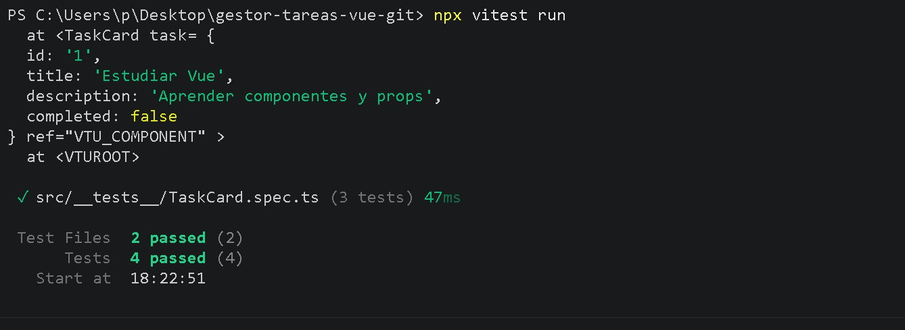
- **`npm error ENOENT ... C:\WINDOWS\system32\package.json`.** *Causa:* PowerShell abierto como administrador arranca fuera del proyecto. *Solución:* entrar con `cd` a la carpeta del repositorio o usar la terminal de VS Code.
- **Commits sin atribución.** *Causa:* el correo de `git config` no estaba registrado en la cuenta de GitHub. *Solución:* usar el correo `noreply` que GitHub muestra en la configuración de correos.
- **`5 moderate severity vulnerabilities`** tras `npm install`. No se aplicó `npm audit fix --force` para no alterar versiones del proyecto compartido.

## Bloque 7: Ecosistema y despliegue

### 7.1. Herramientas del ecosistema
| Herramienta | Uso en el proyecto |
|---|---|
| create-vue | Generó el proyecto con Router, Pinia y Vitest |
| Vite | Servidor de desarrollo y build de producción |
| Vue Router | Rutas `/` (listado) y `/task/:id` (detalle) |
| Pinia | Store `tasks` compartido por `HomeView` y `TaskDetailView` |
| Vitest + Vue Test Utils | Pruebas unitarias |
| Vue DevTools (`vite-plugin-vue-devtools`) | Inspección de componentes, props y estado de Pinia en desarrollo |
| Extensiones de VS Code (`Vue.volar`, `vitest.explorer`) | Soporte de `.vue` con TypeScript y ejecución de pruebas desde el editor |
| JSON Server | API REST a partir de `db.json` |
| Lighthouse (Chrome DevTools) | Medición de rendimiento de la app publicada |

No usamos librería de UI: el diseño es CSS propio con estilos `scoped` y `media queries`.

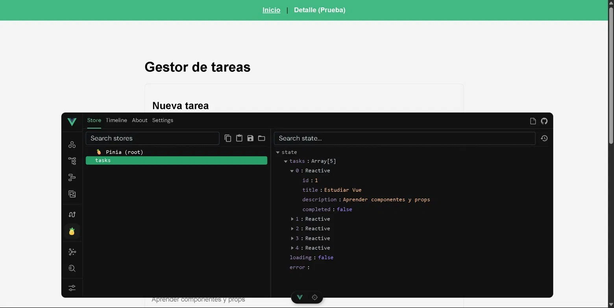

### 7.2. Build de producción
`npm run build` ejecuta `vue-tsc --build` (verificación de tipos) y `vite build`. Resultado: 43 módulos transformados en 409 ms, sin errores de TypeScript. La vista de detalle se carga con `import()` en el router, por eso Vite la separa en su propio archivo (*code splitting*):

| Archivo | Tamaño | Gzip |
|---|---|---|
| `index-*.js` | 104.96 kB | 40.67 kB |
| `TaskDetailView-*.js` | 1.71 kB | 0.93 kB |
| `index-*.css` | 1.47 kB | 0.58 kB |
| `TaskDetailView-*.css` | 0.81 kB | 0.39 kB |
| `index.html` | 0.44 kB | 0.29 kB |

Tamaño total de `dist`: **111.03 KB**.

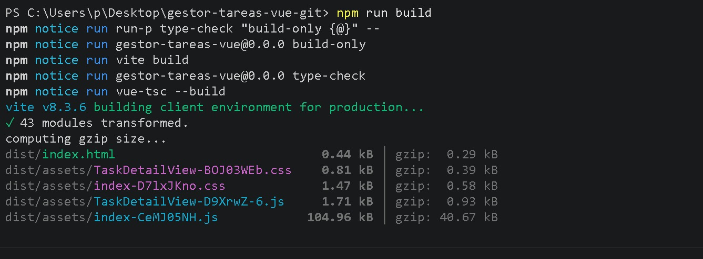
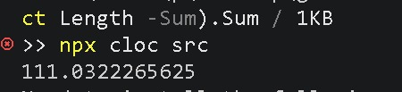

### 7.3. Despliegue
- **API:** JSON Server en Render (plan gratuito): `https://gestor-tareas-vue.onrender.com/tasks`. Comando de inicio: `npx json-server db.json --host 0.0.0.0 --port $PORT`, con `NODE_VERSION=22.18.0`. Limitaciones: el servicio se suspende por inactividad (la primera petición puede tardar cerca de un minuto) y el disco es temporal, por lo que los cambios se pierden al reiniciar.
- **Frontend:** Vercel, desplegado con la CLI (`npx vercel --prod`) desde la carpeta local. Como el repositorio pertenece a otro integrante, no se conectó el despliegue automático y cada cambio requiere repetir el comando.
- La URL de la API se lee de `VITE_API_URL` (`.env.production`), con `localhost:3000` por defecto en desarrollo.
- `vercel.json` redirige todas las rutas a `index.html` para que Vue Router resuelva `/task/:id` al recargar.

**URL pública:** https://gestor-tareas-vue.vercel.app

Verificado en la URL pública: el listado carga las tareas desde Render, recargar en `/task/1` no da 404, y crear, editar, marcar y eliminar funcionan.

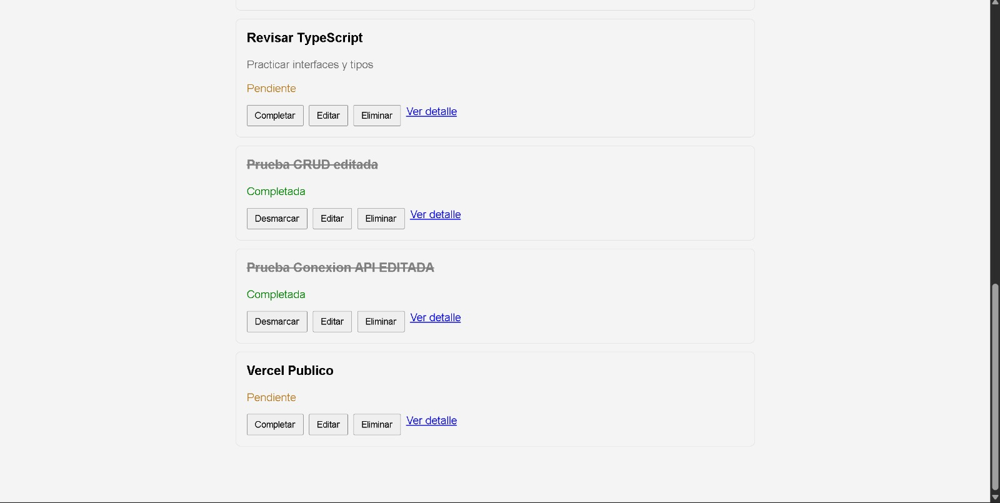
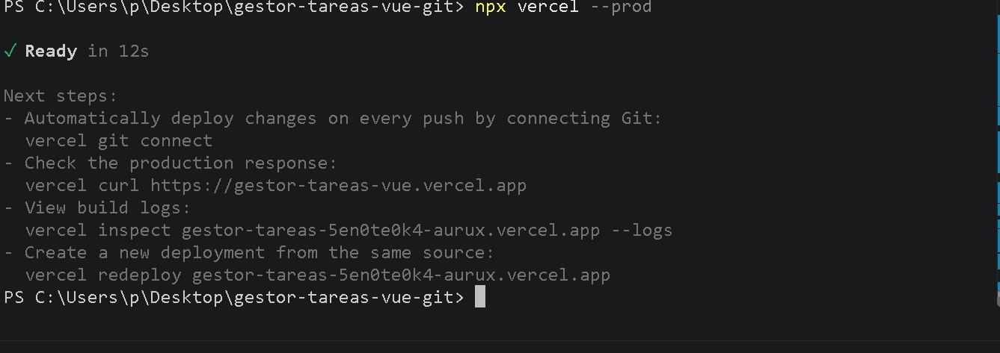

En la vista móvil aparece una barra de desplazamiento horizontal en pantallas angostas, probablemente por la fila de botones de `TaskCard`. Queda anotado como limitación del diseño responsive.

### 7.4. Errores encontrados y solución
- **`'"perl"' is not recognized as an internal or external command`** al ejecutar `npx cloc src`. *Causa:* el paquete `cloc` de npm es un script en Perl y Windows no lo trae. *Solución:* descargar `cloc.exe` desde los releases de AlDanial/cloc y ejecutar `.\cloc.exe src`.
- **`Error: No existing credentials found`** al usar `npx vercel`. *Causa:* primera vez con la CLI, sin sesión. *Solución:* `npx vercel login` y autorizar en el navegador.
- **`Error: Failed to connect luisPl69/gestor-tareas-vue to project`.** *Causa:* respondimos "yes" a conectar el repositorio, pero pertenece a otro usuario. *Solución:* el despliegue se hizo igual desde la carpeta local; sin despliegue automático, cada cambio requiere `npx vercel --prod`.
- **Render autocompletó `npm install && npm run build` y `yarn start`.** *Causa:* asumió una app Node normal. *Solución:* `npm install` y `npx json-server db.json --host 0.0.0.0 --port $PORT`.

## Tabla de mediciones
| Métrica | Valor | Evidencia |
|---|---|---|
| Tiempo de configuración inicial (min) | [Integrante 1] | |
| Líneas de código (`cloc src`) | 779 (467 Vue y 312 TypeScript, 17 archivos) | `docs/img/11-cloc.png` |
| Tamaño del build (carpeta `dist`) | 111.03 KB | `docs/img/10-tamano-dist.png` |
| Lighthouse rendimiento (móvil) | 100 en el listado `/` y 100 en el detalle `/task/1` (FCP 1.2 s, LCP 1.2 a 1.3 s) | `docs/img/15-lighthouse-listado.png`, `docs/img/14-lighthouse-detalle.png` |
| Horas totales del grupo | [suma de los 4] | |
| Dificultad percibida (1 a 5) | [promedio de los 4] | |

Lighthouse se midió con la API despierta. Accessibility dio 88 y 89, Best Practices 100 y SEO 82.

## Uso de Inteligencia Artificial en el Desarrollo

**Justificación metodológica**  
La inteligencia artificial se utilizó estrictamente como una herramienta de apoyo pedagógico, de depuración técnica y de optimización del flujo de trabajo. Su función se limitó a explicar conceptos teóricos de Vue 3 y TypeScript, resolver errores específicos del entorno (como conflictos de Git en Windows o dependencias de Node) y proponer estructuras de pruebas unitarias. En ningún caso se delegó la lógica de negocio, la arquitectura del estado con Pinia o la redacción final del código, los cuales fueron desarrollados, comprendidos y validados manualmente por cada integrante del equipo para garantizar el dominio real de la materia.

**Consultas realizadas por integrante**

**Integrante 1 (Configuración, Enrutamiento y Documentación Inicial)**  
- Resolución de congelamiento de terminal en Git Bash durante `npm create vue@latest`.  
- Solución al error `fatal: detected dubious ownership in repository` en Windows.  
- Manejo de rechazos en `git push` por conflictos con el README inicial remoto (non-fast-forward) y uso seguro de `git push --force`.  
- Diferenciación arquitectónica entre las carpetas `views` y `components`.  
- Configuración desde cero de `router/index.ts` con `createWebHistory` para `HomeView` y `TaskDetailView`.  
- Redacción en Markdown de los Bloques 1 y 2, documentando los errores de permisos.

**Integrante 2 (Fundamentos de Vue 3 y TypeScript)**  
- Estructura básica y flujo de trabajo de Vue 3.  
- Organización y comunicación de componentes mediante `props` y `emit`.  
- Mecanismos de reactividad: uso y diferencia entre `ref()`, `computed()` y `watch()`.  
- Manejo de formularios con `v-model` y lógica para actualizar datos al editar.  
- Definición de interfaces y tipos de datos en TypeScript.  
- Ejecución de operaciones asíncronas con `async` y `await`.  
- Directivas de renderizado (`v-for`, `v-if`) y manejo de eventos (`@click`).

**Integrante 3 (Gestión de Datos y Red)**  
- Gestión de peticiones HTTP y control de flujo con la Fetch API.  
- Estrategias para capturar y manejar errores de red en solicitudes asíncronas.

**Integrante 4 (Pruebas, Despliegue y Flujo de Trabajo)**  
- Preparación del entorno (clonado, ramas, dependencias) sin afectar el repositorio compartido.  
- Verificación de la coexistencia de `json-server` y Vite en desarrollo.  
- Justificación de la restauración de `db.json` antes de cada commit para mantener la integridad de las pruebas.  
- Redacción y explicación línea por línea de pruebas unitarias en Vitest para `TaskCard`, `TaskFilters`, `TaskForm` y el store de Pinia (con `vi.mock`).  
- Explicación del entorno `jsdom` para ejecutar pruebas sin navegador ni API activa.  
- Reemplazo limpio de `TaskDetailView.vue` sin mezclar código legado.  
- Configuración del servicio en Render para `json-server` y uso de variables de entorno (`VITE_API_URL`) con `vercel.json`.  
- Medición de líneas de código en Windows con `cloc.exe` y análisis del tamaño de la carpeta `dist`.  
- Autenticación y despliegue a producción con Vercel CLI desde la carpeta local.  
- Verificación de la URL pública (CRUD, recarga en `/task/1`) y medición de Lighthouse en modo móvil.  
- Ensamblaje de los Bloques 6 y 7 del README sin sobrescribir el trabajo de los compañeros.  
- Creación de Pull Request, fusión a `main` y actualización local sin pérdida de archivos.